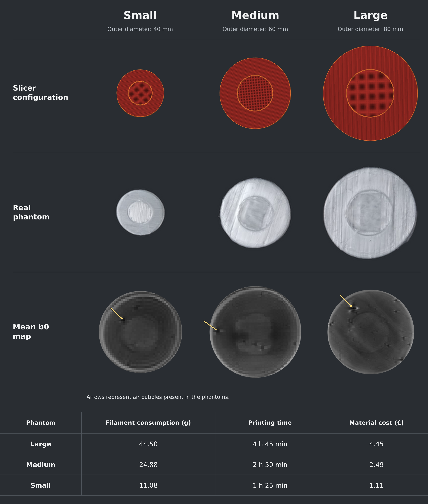

# 7T 3D Printed Diffusion MRI Phantoms

**Exploring Diameter-Dependent Diffusion Metric Changes During PVA Dissolution in 3D-Printed Axon-Mimetic 7T MRI Phantoms**

**Research repository · 7T diffusion MRI · 3D printing · Quantitative MRI · Longitudinal phantom characterization**

This repository documents the design, fabrication, preparation, 7T MRI acquisition, and quantitative characterization of three custom 3D-printed axon-mimetic diffusion phantoms. The exploratory study explore Diameter-Dependent Diffusion Metric Changes During PVA Dissolution in 3D-Printed Axon-Mimetic 7T MRI Phantoms

> **Study status:** Eight MRI sessions over 25 days. Findings are exploratory and do not establish a definitive PVA dissolution time, a causal mechanism, or an optimal phantom diameter.

## Scientific background and aim

Validating diffusion MRI measurements remains challenging. Physical diffusion phantoms offer controlled structures, but conventional designs can be costly and difficult to customize. GEL-LAY 3D printing provides an accessible route to customizable, axon-mimetic structures. Dissolution of the filament's water-soluble PVA component creates microscopic pores that may support anisotropic diffusion. Because the pores are expected to be predominantly oriented within the printing plane, phantom diameter may affect lateral water penetration and the time course of dissolution.

**Aim:** Explore diameter-dependent temporal changes in fractional anisotropy (FA), mean diffusivity (MD), and orientation dispersion index (ODI) in parallel- and crossing-fiber regions during preparation for 7T diffusion MRI.

## Phantom geometry

Three disc-shaped phantoms were designed in **Autodesk Fusion 360** and sliced in **PrusaSlicer**. Each contains a central region mimicking fibers crossing at 90° and a surrounding annulus of parallel fibers.

| Phantom | Outer diameter | Central crossing-region diameter | Thickness | Crossing angle |
|---|---:|---:|---:|---:|
| Small | 40 mm | 20 mm | 6.7 mm | 90° |
| Medium | 60 mm | 30 mm | 6.7 mm | 90° |
| Large | 80 mm | 40 mm | 6.7 mm | 90° |

The central crossing diameter is half the outer diameter in all designs; thickness and nominal printing strategy were held constant.

## 3D printing and phantom preparation

| Parameter | Value |
|---|---|
| Printing technology | Fused deposition modeling (FDM) |
| Printer | Prusa XL |
| Filament | GEL-LAY |
| Nozzle diameter | 0.4 mm |
| Layer height | 0.1 mm |
| Extrusion width | 0.4 mm |
| Central crossing-region infill | 99% grid |
| Outer parallel-region infill | 100% parallel lines |
| Water immersion | 500 mL room-temperature tap water per phantom |
| Water replacement | Daily |

**PrusaSlicer modifier:** The central crossing region was implemented as a smaller, centered modifier within the main disc, allowing its 99% grid infill to differ from the surrounding 100% parallel-line infill. Other print settings apply to the main object or are inherited from the overall slicer configuration.

| Phantom | Filament used | Printing time | Estimated material cost |
|---|---:|---:|---:|
| Small | 11.08 g | 1 h 25 min | €1.11 |
| Medium | 24.88 g | 2 h 50 min | €2.49 |
| Large | 44.50 g | 4 h 45 min | €4.45 |

## MRI acquisition

Eight scanning sessions per phantom were conducted approximately twice weekly across 25 days during immersion.

| Parameter | Protocol |
|---|---|
| Scanner | 7T MAGNETOM Terra.X Impulse Edition (Siemens Healthineers) |
| RF coil | 8Tx/64Rx head coil |
| DWI acquisition | Multi-shell |
| DWI resolution | 1 × 1 × 1 mm³ isotropic |
| DWI TR / TE | 7000 / 35 ms |
| b-values | 0, 1000, 2500 s/mm² |
| b = 0 | 4 averages |
| b = 1000 | 30 directions |
| b = 2500 | 64 directions |
| Structural scan | MP2RAGE, 0.7 mm isotropic |
| MP2RAGE TR / TE | 6000 / 1.7 ms |
| MP2RAGE TI1 / TI2 | 800 / 2700 ms |

**Acquisition timeline:** Session 1 (day 1), session 2 (day 4), session 3 (day 8), session 4 (day 11), session 5 (day 15), session 6 (day 18), session 7 (day 23), and session 8 (day 25).

## Processing and quantitative analysis

Preprocessing and analysis used **MRtrix3**, **FSL**, and **Python**, including diffusion-image denoising, diffusion metric estimation, and manual ROI delineation. Tensor-derived **FA** and **MD** and NODDI-derived **ODI** maps were evaluated. Two manually defined, filtered, slice-based ROIs were used for each phantom: a **central crossing-fiber ROI (C-ROI)** and a **surrounding parallel-fiber ROI (P-ROI)**. Mean metric values were extracted from the middle slice for each session.

## Results: eight-session longitudinal observations

### Fractional anisotropy

The expected **C-ROI FA < P-ROI FA** contrast appeared in the small phantom from day 15 (0.481 vs 0.548) and in the large phantom from day 18 (0.406 vs 0.424). The medium phantom fluctuated and showed this contrast by day 25 (0.512 vs 0.529). Low-FA bands were visible in the parallel regions of medium and large phantoms, suggesting potential printing-related artifact causes localized water accumulation.

### Mean diffusivity

MD maps showed spatial changes progressing from the edges of the crossing regions toward their centers, potentially due to printing limitations resulting in lower fiber density at the crossing-region edges compared with their centers. On day 25, crossing-region MD was **1.059** (small), **1.001** (medium), and **0.661** (large), expressed in **10⁻³ mm²/s**. The lower crossing-region MD and ODI in the large phantom may indicate incomplete PVA dissolution, potentially explaining the early temporarily observed FA contrast between crossing and parallel regions.

### Orientation dispersion index

On day 25, crossing-region ODI was 0.086 (small), 0.075 (medium), and 0.306 (large). Crossing ODI exceeded parallel ODI by day 23 only in the small phantom, potentially because the medium and large phantoms require more time for PVA dissolution.

### Summary

The smaller phantom exhibited earlier changes in diffusion metrics, suggesting faster dissolution, while the low-FA bands in larger phantoms suggest a greater risk of printing artifacts, highlighting the need for careful handling and size-specific printing settings.

## Interpretation and limitations

- **Diameter and dissolution:** Diameter was varied to explore its possible influence on lateral water penetration and PVA dissolution. The data suggest earlier metric changes in smaller phantoms but do not directly quantify dissolved PVA or pore connectivity.
- **Printing heterogeneity:** Low-FA bands in medium and large parallel regions may reflect printing artifacts and localized water trapping. Structural imaging is required to confirm this interpretation.
- **Air bubbles:** Air bubbles were visible in mean b = 0 images and may influence image quality and quantitative metrics.

**Future work:** Use micro-CT to characterize pore geometry and connectivity, evaluate more complex white-matter-mimicking geometries using customized printer instructions, optimize diameter-specific printing parameters, and assess vacuum degassing to reduce trapped air.

## Figures and Results

### Figure 1. Phantom Configuration, Photographs, Mean b = 0 Images, and Printing Summary

### Figure 2. Longitudinal FA, MD, and ODI Measurements

### Figure 3. Longitudinal Mean Diffusivity (MD) Maps

### Figure 4. Longitudinal Fractional Anisotropy (FA) Maps

## Reproducibility notes

- Print geometry, infill, water replacement, and acquisition parameters are documented above.
- Comparisons use manually delineated, filtered middle-slice ROIs; ROI placement can influence the means.
- The reported material costs are estimates based on filament consumption and do not include labor, equipment, electricity, or imaging costs.

## Project and attribution

Developed as part of research on customizable axon-mimetic diffusion MRI phantoms at **Otto von Guericke University Magdeburg**, Germany.

**Repository:** [SaifQasem29/7T-Diffusion-MRI-Phantoms](https://github.com/SaifQasem29/7T-3D-Printed-Diffusion-MRI-Phantoms)

**Contact / maintainer:** [Saif Qasem](https://github.com/SaifQasem29)

If you use these designs or analysis materials, please acknowledge the repository and any associated publication when available. No software license is implied unless a `LICENSE` file is added.

## References

1.	Jelescu IO, Budde MD. Design and Validation of Diffusion MRI Models of White Matter. Front Phys. 2017 Nov 28;5:61. doi:10.3389/fphy.2017.00061 
2.	Mushtaha FN, Kuehn TK, El-Deeb O, Rohani SA, Helpard LW, Moore J, et al. Design and characterization of a 3D-printed axon-mimetic phantom for diffusion MRI. Magn Reson Med. 2021 Nov;86(5):2482–96. doi:10.1002/mrm.28886 PubMed PMID: 34196049; PubMed Central PMCID: PMC8596689. 
3.	Kuehn TK, Mushtaha FN, Khan AR, Baron CA. Enabling Complex Fibre Geometries Using 3D Printed Axon-Mimetic Phantoms. Front Neurosci. 2022 Apr 7;16:833209. doi:10.3389/fnins.2022.833209 

